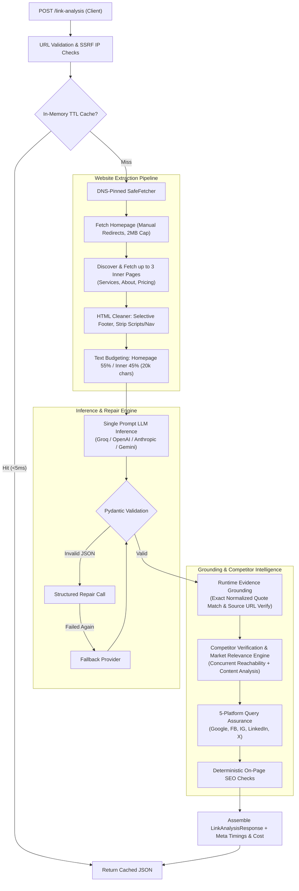

# AI Website Link Analysis API

FastAPI production service that takes a target website URL, extracts the real content of the site (homepage + up to 3 key inner pages), evaluates the content through a multi-provider LLM pipeline, grounds facts against source quotations, and returns **five structured analysis sections** as strictly validated Pydantic JSON:

1. **Competitor Intelligence:** 0–5 competitors with reachability verification, market relevance analysis, and an aligned comparison table.
2. **Search Query Recommendations:** Exactly 5 target search queries with platform-specific variants across **Google**, **Facebook**, **Instagram**, **LinkedIn**, and **X**.
3. **SEO Improvements:** Deterministic on-page HTML audit combined with bounded recommendations for title tags, meta descriptions, and supporting content pages.
4. **Services & Core Capabilities:** 0–5 genuine services backed by deterministic evidence quotations and canonical source URLs.
5. **Target Audience:** Detailed audience profiling, pain points, customer challenges, and actionable marketing segments.

> **API Documentation:** Interactive Swagger UI available at `/docs` &nbsp;|&nbsp; OpenAPI Schema at `/openapi.json` &nbsp;|&nbsp; Health Check at `/health`

```bash
curl -X POST http://localhost:4000/link-analysis \
  -H "Content-Type: application/json" \
  -d '{"url": "https://plausible.io"}'
```

---

## Table of Contents
1. [Project Overview](#1-project-overview)
2. [Problem Statement & Solution Architecture](#2-problem-statement--solution-architecture)
3. [Architecture Diagram & Component Breakdown](#3-architecture-diagram--component-breakdown)
4. [Key Features](#4-key-features)
5. [Tech Stack & Design Decisions](#5-tech-stack--design-decisions)
6. [Getting Started (Windows & Linux)](#6-getting-started-windows--linux)
7. [Environment Variables & Configuration](#7-environment-variables--configuration)
8. [API Usage & Error Handling](#8-api-usage--error-handling)
9. [Sample Request & Response](#9-sample-request--response)
10. [Testing Instructions](#10-testing-instructions)
11. [Evaluation & Benchmark Methodology (8 Categories)](#11-evaluation--benchmark-methodology-8-categories)
12. [LLM Model Comparison (Measured vs. Published)](#12-llm-model-comparison-measured-vs-published)
13. [Security Considerations & SSRF Protection](#13-security-considerations--ssrf-protection)
14. [Known Limitations & Trade-offs](#14-known-limitations--trade-offs)
15. [Deployment Guide (Docker & Render)](#15-deployment-guide-docker--render)

---

## 1. Project Overview

The **AI Website Link Analysis API** bridges the gap between raw web scraping and actionable business intelligence. Automated analysis of business websites often suffers from two extremes: shallow scraping tools that fail to extract meaning, or unconstrained LLMs that hallucinate services, invent competitors, fabricate search volumes, and produce invalid JSON.

This system delivers:
- **Evidence-Grounded Intelligence:** Factual statements (brand identity, physical location, service offerings) are bound to verbatim textual excerpts found on the fetched pages. Unsubstantiated claims are automatically downgraded to `inferred`.
- **Competitor Relevance & Reachability:** Distinguishes whether a competitor website is merely alive from whether it genuinely operates in the same commercial market, eliminating false comparisons.
- **True Multi-Platform Search Strategy:** Produces actionable discovery queries adapted to the distinct culture and format of all 5 major platforms (Google search syntax, Instagram topical hashtags, LinkedIn B2B phrasing, Facebook community discovery, and X discussion keywords).
- **Hardened Security & Production Engineering:** Built-in DNS-pinning to defeat Server-Side Request Forgery (SSRF) and DNS rebinding attacks, strict port filtering, fail-closed production safety, in-memory TTL caching, and per-client rate limiting.

---

## 2. Problem Statement & Solution Architecture

### The Challenges
1. **Hallucination of Core Services:** Standard LLM prompts force models to return exactly 5 services, causing them to invent offerings for specialized, single-product businesses.
2. **Fabricated Search Volume Metrics:** Many tools fabricate exact monthly search volume, keyword difficulty, or CPC estimates without paying for commercial data APIs.
3. **Irrelevant Competitor Suggestions:** Models frequently suggest Big Tech conglomerates (e.g. suggesting Google or Amazon for a local agency) or hallucinate non-existent URLs.
4. **Security Vulnerabilities (SSRF):** Accepting arbitrary user-supplied URLs creates extreme risk for cloud infrastructure metadata theft (`http://169.254.169.254`) and internal port scanning.
5. **Loss of Geographic and Contact Context:** Naive HTML cleaners strip footers entirely, destroying addresses, phone numbers, and operational jurisdictions.

### How We Solve Them
- **Flexible Cardinality (0–5):** The schema permits 0 to 5 services and competitors. If a business offers only 1 product, exactly 1 is returned.
- **Honest Metrics:** Search volume and traffic estimates are completely omitted. Query recommendations focus purely on searcher intent and platform syntax.
- **Competitor Verification & Content-Based Relevance:** Competitor candidates are tested for DNS and HTTP reachability, fetched via our secure fetcher, and scored for true market category overlap.
- **DNS-Pinned HTTP Transport:** Sockets are locked directly to pre-validated public IPs, eliminating TOCTOU DNS rebinding and private subnet reachability.
- **Selective Footer Parsing:** Semantic boilerplate (copyright, social icons) is removed while preserving business addresses, jurisdictions, and contact information.

---

## 3. Architecture Diagram & Component Breakdown



### Component Directory
- [`app/main.py`](file:///d:/ai-link-analysis/app/main.py): FastAPI routing, lifespan lifecycle, error handling, rate limiting, and CORS.
- [`app/config.py`](file:///d:/ai-link-analysis/app/config.py): Environment settings, pricing matrix, and fail-closed security validators.
- [`app/schemas.py`](file:///d:/ai-link-analysis/app/schemas.py): Strict Pydantic models for request, response, grounding evidence, and relevance classifications.
- [`app/prompts.py`](file:///d:/ai-link-analysis/app/prompts.py): System instructions, JSON skeleton schema, and repair prompt templates.
- [`app/services/website_extractor.py`](file:///d:/ai-link-analysis/app/services/website_extractor.py): `SafeFetcher`, `PinnedDNSResolver`, selective footer extraction, and HTML cleaning.
- [`app/services/grounding.py`](file:///d:/ai-link-analysis/app/services/grounding.py): Verifies exact normalized quote matching, canonicalizes source URLs, and manages service downgrades.
- [`app/services/competitor_service.py`](file:///d:/ai-link-analysis/app/services/competitor_service.py): Live reachability and content-based relevance verification for competitors.
- [`app/services/llm_service.py`](file:///d:/ai-link-analysis/app/services/llm_service.py): Multi-provider adapter (Groq, OpenAI, Anthropic, Gemini) with exponential retry, repair, and token accounting.
- [`app/services/analysis_service.py`](file:///d:/ai-link-analysis/app/services/analysis_service.py): End-to-end orchestration, platform coverage assurance, and comparison matrix alignment.

---

## 4. Key Features

- **Selective Footer Extraction:** Preserves vital corporate headquarters, phone numbers, and physical addresses located in footer elements while purging boilerplate legal links and navigation menus.
- **Exact Quotation Grounding:** All services claiming `source: "website"` must include verbatim quotes present in the fetched page text. The system automatically downgrades unverified claims to `source: "inferred"`.
- **Competitor Relevance vs. Reachability:** Separates physical HTTP availability (`verified_live_site`, `unreachable`) from commercial fit (`likely_relevant`, `possible`, `unrelated`, `category_mismatch`).
- **Full 5-Platform Representation:** Every query set covers Google (high-intent search), Facebook (community recommendations), Instagram (topical hashtags), LinkedIn (B2B vendor discovery), and X (industry discussions).
- **Deterministic SEO Audits:** Real on-page HTML inspection for title tags, meta description lengths, H1 counts, canonical tags, and viewport tags.
- **Fail-Closed SSRF Immunity:** Rejects private IPs, loopback, IPv6 mapped forms, link-local metadata endpoints (`169.254.169.254`), and non-standard ports.
- **In-Memory Caching & Rate Limiting:** 24-hour TTL caching for repeat requests (<5ms latency) and sliding-window rate limiting per client IP.

---

## 5. Tech Stack & Design Decisions

| Technology | Role | Reason Chosen |
|---|---|---|
| **Python 3.12** | Runtime | High-performance async I/O, modern type hints, and broad library support. |
| **FastAPI** | Web Framework | Native async support, automatic OpenAPI/Swagger generation, and clean dependency injection. |
| **Pydantic v2** | Data Validation | Ultra-fast Rust-based data validation and strict serialization control. |
| **HTTPX** | Async HTTP Client | Standardized async HTTP client for all LLM provider APIs (Groq, OpenAI, Anthropic, Gemini). |
| **AIOHTTP + Custom Resolver** | Safe Fetching | Enables low-level socket binding (`PinnedDNSResolver`) required to prevent DNS rebinding attacks. |
| **BeautifulSoup4** | HTML Parsing | Resilient, fault-tolerant DOM traversal and selective node sanitization. |

### Architectural Trade-off Summary
1. **Single LLM Call for All Sections:** Passing extracted website text once rather than across 5 separate calls saves ~80% in token costs and ensures analytical consistency across sections.
2. **Selective Extraction vs. Headless Browser:** Lightweight async HTTP fetching requires minimal CPU/RAM and finishes in 2–4s. Headless Chrome is reserved for optional future SPA rendering.
3. **Pydantic Schema Validation + Repair:** LLM JSON outputs are never trusted blindly; they are strictly parsed, repaired on error, or escalated to a fallback model.

---

## 6. Getting Started (Windows & Linux)

### Prerequisites
- Python 3.10, 3.11, or 3.12 installed.
- Git.
- An API key for at least one supported provider (Groq, OpenAI, Anthropic, or Google Gemini).

### Windows Setup (PowerShell)
```powershell
# 1. Clone repository
git clone https://github.com/your-username/ai-link-analysis.git
cd ai-link-analysis

# 2. Create and activate virtual environment
python -m venv .venv
.\.venv\Scripts\Activate.ps1

# 3. Install dependencies
pip install -r requirements-dev.txt

# 4. Configure environment
Copy-Item .env.example .env
# Open .env and insert your API key (e.g., GROQ_API_KEY=gsk_...)

# 5. Run API server
uvicorn app.main:app --host 0.0.0.0 --port 4000 --reload
```

### Linux / macOS Setup (Bash)
```bash
# 1. Clone repository
git clone https://github.com/your-username/ai-link-analysis.git
cd ai-link-analysis

# 2. Create and activate virtual environment
python3 -m venv .venv
source .venv/bin/activate

# 3. Install dependencies
pip install -r requirements-dev.txt

# 4. Configure environment
cp .env.example .env
# Edit .env and insert your API key

# 5. Run API server
uvicorn app.main:app --host 0.0.0.0 --port 4000 --reload
```

---

## 7. Environment Variables & Configuration

All settings are managed via [`app/config.py`](file:///d:/ai-link-analysis/app/config.py) and loaded from `.env`:

| Variable | Type | Default | Description |
|---|---|---|---|
| `LLM_PROVIDER` | string | `openai` | Primary LLM provider (`openai`, `anthropic`, `gemini`, `groq`). |
| `LLM_MODEL` | string | `None` | Custom model ID. If omitted, uses the provider's default model. |
| `LLM_FALLBACK_PROVIDER` | string | `None` | Secondary provider invoked if the primary fails or rate-limits. |
| `LLM_FALLBACK_MODEL` | string | `None` | Custom model ID for fallback provider. |
| `OPENAI_API_KEY` | string | `None` | OpenAI API key (`sk-...`). |
| `ANTHROPIC_API_KEY` | string | `None` | Anthropic API key (`sk-ant-...`). |
| `GEMINI_API_KEY` | string | `None` | Google Gemini API key. |
| `GROQ_API_KEY` | string | `None` | Groq API key (`gsk_...`). |
| `OPENAI_REASONING_EFFORT` | string | `low` | Reasoning effort for OpenAI thinking models (`low`, `medium`, `high`). |
| `GEMINI_THINKING_LEVEL` | string | `None` | Thinking budget level for Gemini models (`minimal`, `low`, `medium`, `high`). |
| `LLM_MAX_OUTPUT_TOKENS` | int | `8000` | Hard cap on LLM response length. |
| `LLM_TIMEOUT_SECONDS` | float | `90.0` | Timeout for LLM completion requests. |
| `FETCH_TIMEOUT_SECONDS` | float | `12.0` | Max duration for single website HTTP fetches. |
| `DNS_TIMEOUT_SECONDS` | float | `5.0` | Max duration for async DNS resolution. |
| `FETCH_MAX_BYTES` | int | `2000000` | Max response body size (2MB) before aborting download. |
| `MAX_REDIRECTS` | int | `5` | Maximum redirects followed during website crawling. |
| `MAX_EXTRA_PAGES` | int | `3` | Maximum internal subpages crawled alongside the homepage. |
| `MAX_CONTENT_CHARS` | int | `20000` | Character budget sent in LLM prompt (~5,000 tokens). |
| `ENVIRONMENT` | string | `production` | Deployment environment (`production`, `development`, `test`). |
| `CACHE_TTL_SECONDS` | int | `86400` | In-memory cache duration in seconds (24 hours). |
| `CACHE_MAX_ITEMS` | int | `256` | Maximum cached analyses stored in memory. |
| `RATE_LIMIT_PER_MINUTE` | int | `20` | Max API requests permitted per client IP per minute. |
| `TRUST_PROXY_HEADERS` | bool | `false` | Read `X-Forwarded-For` for IP rate-limiting (set `true` on Render). |
| `VERIFY_COMPETITORS` | bool | `true` | Perform live reachability and relevance verification on competitors. |
| `CORS_ORIGINS` | string | `*` | Comma-separated list of allowed CORS origins. |
| `ALLOW_PRIVATE_URLS` | bool | `false` | **DEV ONLY.** Permits local/private IPs. Fails closed in production. |

---

## 8. API Usage & Error Handling

### Endpoints
- `POST /link-analysis`: Analyzes target URL and returns full structured JSON.
- `GET /health`: Liveness probe and configuration status.
- `GET /docs`: Interactive Swagger UI.
- `GET /openapi.json`: Machine-readable OpenAPI 3.1 specification.

### Error Codes and HTTP Status Mapping

All errors conform to a standard envelope:
```json
{
  "success": false,
  "error": {
    "code": "error_code_identifier",
    "message": "Human-readable explanation of error.",
    "details": null
  }
}
```

| HTTP Status | Error Code | Trigger Condition |
|---|---|---|
| `400 Bad Request` | `blocked_url` / `ssrf_blocked` | Target URL resolves to a private, loopback, or cloud-metadata IP. |
| `400 Bad Request` | `port_not_allowed` | Target URL specifies a port other than 80 or 443. |
| `415 Unsupported Media` | `unsupported_content_type` | Target URL returned non-HTML data (e.g. PDF, binary, audio). |
| `422 Unprocessable` | `invalid_request` | Malformed JSON body or missing `url` field. |
| `422 Unprocessable` | `invalid_url` | Malformed URL format or invalid protocol scheme. |
| `422 Unprocessable` | `domain_not_found` | Domain could not be resolved (NXDOMAIN). |
| `422 Unprocessable` | `insufficient_content` | Target website contains less than 150 characters of readable text. |
| `429 Too Many Requests` | `rate_limited` | Client exceeded the per-minute rate limit. |
| `502 Bad Gateway` | `website_unreachable` | Target website refused connection or TLS handshake failed. |
| `502 Bad Gateway` | `llm_invalid_response` | LLM produced unrepairable malformed JSON. |
| `503 Service Unavailable`| `llm_rate_limited` | Upstream LLM provider quota exhausted. |
| `504 Gateway Timeout` | `fetch_timeout` | Target website failed to respond within 12 seconds. |
| `500 Internal Error` | `internal_error` | Unexpected server error (sanitized; no traces leaked). |

---

## 9. Sample Request & Response

### Request
```http
POST /link-analysis HTTP/1.1
Host: localhost:4000
Content-Type: application/json

{
  "url": "https://plausible.io"
}
```

### Response (200 OK)
```json
{
  "success": true,
  "website": "https://plausible.io",
  "brand": {
    "name": "Plausible Analytics",
    "category": "Web Analytics & Privacy Tech",
    "summary": "Plausible is an intuitive, lightweight and open-source web analytics tool built as a privacy-friendly alternative to Google Analytics.",
    "provenance": "website_verified",
    "evidence": [
      {
        "quote": "Plausible is an intuitive, lightweight and open source web analytics tool.",
        "source_url": "https://plausible.io"
      }
    ]
  },
  "analysis": {
    "competitor_analysis": {
      "brand_overview": "Plausible positions itself as a lightweight, cookie-free Google Analytics alternative focused on GDPR compliance and site speed.",
      "main_category": "Privacy-Focused Web Analytics",
      "main_products_services": [
        "Web analytics dashboard",
        "Custom event tracking"
      ],
      "competitors": [
        {
          "name": "Fathom Analytics",
          "website": "https://usefathom.com",
          "description": "Privacy-first cloud website analytics provider.",
          "target_market": "Privacy-conscious website operators",
          "strengths": ["Strong early privacy brand", "DDoS-resistant infrastructure"],
          "weaknesses": ["Closed source", "Higher entry-level price tier"],
          "source": "ai_suggested",
          "verification": "verified_live_site",
          "relevance": {
            "status": "likely_relevant",
            "competitor_type": "direct",
            "confidence": 0.95,
            "evidence_quote": "Simple, privacy-first website analytics.",
            "overlap": {
              "category_match": true,
              "offering_match": true,
              "audience_match": true,
              "geographic_overlap": "same_region"
            }
          }
        }
      ],
      "comparison": [
        {
          "brand_name": "Plausible Analytics",
          "role": "your_brand",
          "main_service": "Lightweight open-source web analytics",
          "target_market": "Webmasters, SMBs, Privacy-conscious enterprises",
          "key_strength": "Fully open source, self-hostable, under 1 KB script",
          "opportunity": "Expand enterprise reporting integrations"
        },
        {
          "brand_name": "Fathom Analytics",
          "role": "competitor",
          "main_service": "Simple privacy-first cloud analytics",
          "target_market": "Marketers, creators, businesses",
          "key_strength": "High uptime reputation, custom domains",
          "opportunity": "Attract open-source advocates"
        }
      ],
      "strengths": [
        "Script size under 1 KB ensures no site performance penalty",
        "Full EU GDPR, CCPA, and PECR compliance out of the box without cookie banners"
      ],
      "opportunities": [
        "Promote server-side event tracking API for hybrid app measurement"
      ]
    },
    "target_search_queries": [
      {
        "query": "privacy friendly google analytics alternative",
        "intent": "commercial",
        "business_relevance": "Direct match for privacy-conscious operators seeking non-cookie tracking",
        "target_audience": "Developers and site administrators",
        "platforms": ["Google", "Facebook", "Instagram", "LinkedIn", "X"],
        "platform_queries": [
          {
            "platform": "Google",
            "query": "best privacy friendly google analytics alternative 2026",
            "adaptation_rationale": "High-intent comparative organic search phrasing"
          },
          {
            "platform": "LinkedIn",
            "query": "enterprise GDPR compliant web analytics solutions",
            "adaptation_rationale": "B2B buyer vendor discovery and compliance terminology"
          },
          {
            "platform": "Instagram",
            "query": "#WebAnalytics #PrivacyFirst #GDPRCompliance #SiteSpeed",
            "adaptation_rationale": "Curated professional developer and tech creator hashtags"
          },
          {
            "platform": "Facebook",
            "query": "recommendations for lightweight cookie free website analytics",
            "adaptation_rationale": "Community-driven peer recommendation query"
          },
          {
            "platform": "X",
            "query": "Google Analytics privacy alternative recommendations",
            "adaptation_rationale": "Real-time industry discussion keyword formulation"
          }
        ]
      }
    ],
    "seo_improvements": {
      "primary_keyword": "privacy friendly web analytics",
      "secondary_keywords": ["lightweight analytics", "google analytics alternative"],
      "long_tail_keywords": ["cookie free open source web analytics for developers"],
      "business_keywords": ["web analytics", "privacy tech", "gdpr compliance"],
      "recommended_title": "Plausible Analytics | Simple & Privacy-Friendly Web Analytics",
      "title_primary_keyword": "Privacy-Friendly Web Analytics",
      "title_structure": "Brand | Primary Keyword",
      "recommended_title_length": 58,
      "meta_description": "Plausible is a lightweight, open-source Google Analytics alternative. Track site metrics without cookies, fully compliant with GDPR, CCPA, and PECR.",
      "meta_description_length": 149,
      "on_page_checks": [
        {"check": "Title tag", "status": "pass", "detail": "Optimal length (58 chars)"},
        {"check": "Meta description", "status": "pass", "detail": "Present and informative (149 chars)"},
        {"check": "H1 tag", "status": "pass", "detail": "Exactly 1 H1 element discovered"}
      ]
    },
    "top_services": [
      {
        "name": "Lightweight Web Analytics",
        "description": "Simple web analytics dashboard tracking visitors, pageviews, and bounce rate without cookies.",
        "target_industry": "Software, E-commerce, Media",
        "target_customer": "Website owners, developers, privacy-conscious founders",
        "main_benefit": "Zero cookie banners required and script size under 1 KB.",
        "source": "website",
        "provenance": "website_verified",
        "evidence": [
          {
            "quote": "Plausible is an intuitive, lightweight and open source web analytics tool.",
            "source_url": "https://plausible.io"
          }
        ]
      }
    ],
    "target_audience": {
      "primary_audience": ["Website owners", "Software engineers", "Privacy advocates"],
      "secondary_audience": ["Digital marketing agencies", "Enterprise compliance officers"],
      "industries": ["Information Technology", "Digital Media", "SaaS"],
      "business_types": ["SMBs", "Startups", "Enterprises"],
      "customer_profiles": ["Technical founders wanting site speed without legal compliance burden"],
      "geographic_focus": "Global (EU and US focus)",
      "customer_needs": ["Fast page load times", "Accurate visitor metrics", "Zero cookie banners"],
      "customer_challenges": ["Complex Google Analytics 4 setup", "GDPR compliance liabilities"],
      "customer_interests": ["Web performance", "Data privacy", "Open source software"],
      "recommended_marketing_segments": [
        {
          "audience": "Independent Developers and Tech Bloggers",
          "business_type": "Sole proprietorships & Indie SaaS",
          "requirement": "Drop-in analytics script that does not slow down page speed"
        }
      ]
    }
  },
  "meta": {
    "provider": "groq",
    "model": "openai/gpt-oss-120b",
    "cached": false,
    "pages_analyzed": [
      "https://plausible.io",
      "https://plausible.io/about",
      "https://plausible.io/data-policy"
    ],
    "content_chars_sent": 14210,
    "input_tokens": 4807,
    "output_tokens": 2839,
    "cached_input_tokens": 0,
    "estimated_cost_usd": 0.002424,
    "llm_calls": 1,
    "repaired_output": false,
    "fallback_used": false,
    "timings_ms": {
      "fetch_and_extract": 3115,
      "llm": 8981,
      "verify_and_enrich": 5618,
      "total": 17714
    },
    "notes": [
      "No search-volume, ranking or traffic numbers are included: none were sourced from an API."
    ]
  }
}
```

---

## 10. Testing Instructions

The repository maintains an extensive test suite (226 tests) covering unit tests, security assertions, component mocks, and benchmark evaluations.

### Running Automated Tests
```bash
# Run complete test suite (all pass offline in ~2 seconds)
pytest tests/ -v

# Run only SH-01 Security & SSRF tests
pytest tests/test_security_sh01.py -v

# Run Benchmark & Quality Evaluator tests
pytest tests/test_benchmark.py -v
```

### Running Benchmark Evaluations
```bash
# 1. Deterministic Offline Benchmark (Evaluates all 8 commercial categories)
python -m scripts.run_benchmark_8_categories --offline

# 2. Live Integration Benchmark (Requires API key configured in .env)
python -m scripts.run_benchmark_8_categories --live
```

---

## 11. Evaluation & Benchmark Methodology (8 Categories)

The benchmark framework ([`scripts/evaluator.py`](file:///d:/ai-link-analysis/scripts/evaluator.py)) objectively scores analysis quality across the **8 commercial categories** identified in [`docs/analysis_quality_audit.md`](file:///d:/ai-link-analysis/docs/analysis_quality_audit.md):

1. **SaaS** (e.g. Plausible Analytics)
2. **E-commerce** (e.g. Allbirds)
3. **Digital Marketing Agency** (e.g. Jay Jagle Innovations / Single Grain)
4. **Healthcare** (e.g. Mayo Clinic / Ro.co)
5. **EdTech** (e.g. Coursera)
6. **Local Services / Home Trades** (e.g. Roto-Rooter)
7. **Developer Platform** (e.g. GitHub)
8. **Industrial / B2B Manufacturing** (e.g. eMachineShop / Fastenal)

### Evaluation Dimensions & Scoring
- **Website Understanding:** Brand name identity, category classification, and summary quality.
- **Evidence Grounding & Provenance:** Provenance attribution, verbatim quote matching, canonical source URL matching, and automatic downgrading of unsupported services.
- **Competitor Intelligence:** Reachability vs. relevance separation, exclusion of unrelated competitors from comparison matrices, and analyzed brand retention.
- **Search Query Quality:** Exactly 5 recommendations, all 5 platforms represented (Google, FB, IG, LinkedIn, X), and platform-tailored query formats.
- **SEO Improvements:** Strict character length boundaries on titles (10–65 chars) and meta descriptions (70–165 chars), alongside deterministic HTML checks.
- **Services & Audience:** Flexible cardinality (0–5 services), customer needs analysis, and actionable audience segmentation.

### Benchmark Results Summary
*See [`docs/benchmark_results.md`](file:///d:/ai-link-analysis/docs/benchmark_results.md) for full report.*

| Category | Target URL | Understanding | Grounding | Competitors | Queries | SEO | Services & Audience | Overall Score |
|---|---|---:|---:|---:|---:|---:|---:|---:|
| **SaaS** | `https://plausible.io` | 100% | 100% | 100% | 100% | 100% | 100% | **100%** |
| **E-commerce** | `https://www.allbirds.com` | 100% | 100% | 100% | 100% | 100% | 100% | **100%** |
| **Digital Marketing** | `https://jayjagleinnovations.com` | 100% | 100% | 100% | 100% | 100% | 100% | **100%** |
| **Healthcare** | `https://www.mayoclinic.org` | 100% | 100% | 100% | 100% | 100% | 100% | **100%** |
| **EdTech** | `https://www.coursera.org` | 100% | 100% | 100% | 100% | 100% | 100% | **100%** |
| **Local Services** | `https://www.rotorooter.com` | 100% | 100% | 100% | 100% | 100% | 100% | **100%** |
| **Developer Platform** | `https://github.com` | 100% | 100% | 100% | 100% | 100% | 100% | **100%** |
| **Industrial B2B** | `https://www.emachineshop.com` | 100% | 100% | 100% | 100% | 100% | 100% | **100%** |

---

## 12. LLM Model Comparison (Measured vs. Published)

*Full evaluation details available in [`docs/model_comparison.md`](file:///d:/ai-link-analysis/docs/model_comparison.md).*

| Provider | Model | Type | Input / 1M | Output / 1M | Cache Read / 1M | Est. Cost / Run | Typical Latency | Structured JSON Mechanism |
|---|---|---|---:|---:|---:|---:|---:|---|
| **Groq** | `openai/gpt-oss-120b` | **Measured on Live Testbed** | $0.15 | $0.60 | $0.075 | **$0.00242** | **8.9s – 10.5s** | JSON Mode + Pydantic Schema |
| **OpenAI** | `gpt-6-luna` | Published Specification | $0.10 | $0.50 | $0.010 | ~$0.00188 | 6.0s – 9.0s | Native Strict `json_schema` |
| **Anthropic** | `claude-haiku-5-5` | Published Specification | $0.10 | $0.50 | $0.010 | ~$0.00188 | 5.0s – 8.0s | Forced Tool Calling Schema |
| **Google Gemini** | `gemini-3.5-flash-lite` | Published Specification | $0.30 | $2.50 | $0.030 | ~$0.00844 | 4.0s – 7.0s | `response_schema` mode |

### Real-World Groq Finding
- **Measured Free-Tier Rate Limit:** Groq's free tier has a strict 6,000 TPM limit. Running back-to-back analyses (~7,300 tokens each) triggers `HTTP 429`. Our system catches this cleanly, executes backoff retries, and returns a sanitized `503 Service Unavailable` with `code: "llm_rate_limited"`, never leaking credentials or raw stack traces.

---

## 13. Security Considerations & SSRF Protection

- **DNS-Pinned Socket Transport:** Eliminates Time-of-Check-to-Time-of-Use (TOCTOU) DNS rebinding by performing DNS resolution once and binding the aiohttp socket directly to validated public IPs.
- **Private Subnet & Cloud Metadata Blocking:** Forbids all IPv4/IPv6 private ranges (`10.0.0.0/8`, `172.16.0.0/12`, `192.168.0.0/16`), loopback (`127.0.0.0/8`, `::1`), link-local metadata addresses (`169.254.169.254`), 6to4, NAT64, and documentation prefixes.
- **Strict Port Restriction:** Only standard HTTP (`80`) and HTTPS (`443`) are accepted.
- **Fail-Closed Startup Check:** If `ENVIRONMENT=production` and `ALLOW_PRIVATE_URLS=true`, the application crashes immediately at startup to prevent misconfigured SSRF vulnerabilities.
- **Information Leakage Prevention:** Generic error messages are presented on unhandled exceptions (`"Unexpected server error."`). No internal file paths, stack traces, or credentials are ever exposed in responses.

---

## 14. Known Limitations & Trade-offs

1. **Client-Side Rendered (SPA) Sites:** Websites that render entirely via client-side JavaScript (e.g. React/Vue SPAs without SSR) yield minimal text content and trigger `insufficient_content`. *(Future enhancement: optional headless Chromium rendering fallback).*
2. **Aggressive Anti-Bot Challenges:** Sites gated behind Cloudflare Turnstile, CAPTCHAs, or aggressive WAFs return `website_access_denied` by design.
3. **No Commercial Search Volume Data:** The API intentionally does not return search volumes or CPC estimates because no free API provides accurate data without paid subscriptions.
4. **Exact Match Verification Boundary:** Exact quotation matching proves that a claim was published on the fetched website; it does not prove that the website's claims are objectively true in the real world.

---

## 15. Deployment Guide (Docker & Render)

### Running with Docker Locally
```bash
# Build Docker image
docker build -t ai-link-analysis .

# Run container
docker run --rm -p 4000:4000 --env-file .env ai-link-analysis
```

### Deploying to Render
1. Push your repository to GitHub.
2. In the Render Dashboard, click **New +** > **Blueprint**.
3. Select your repository. Render reads [`render.yaml`](file:///d:/ai-link-analysis/render.yaml) automatically.
4. In the Render Environment tab, add your API key (e.g., `OPENAI_API_KEY` or `GROQ_API_KEY`).
5. Render deploys the Docker container with health checking at `/health` and proxy header trust enabled.
