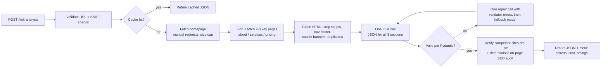

# AI Website Link Analysis API

FastAPI service that takes a website URL, extracts the real content of the site (homepage + key inner pages), sends a cleaned, budgeted version to an LLM and returns **five structured analysis sections** as validated JSON: competitor comparison, top-5 target search queries, SEO improvements, top-5 services and target audience.

> **Live demo:** `https://YOUR-SERVICE.onrender.com` &nbsp;|&nbsp; **API docs:** `https://YOUR-SERVICE.onrender.com/docs` &nbsp;*(replace after deploying, see [Deployment](#deployment))*

```bash
curl -X POST http://localhost:4000/link-analysis -H "Content-Type: application/json" -d '{"url": "https://example.com"}'
```

## Contents
[How it works](#how-it-works) · [Quick start](#quick-start) · [Configuration](#configuration) · [API](#api) · [Requirement coverage](#requirement-coverage) · [Security](#security) · [Testing & evidence](#testing--evidence) · [Deployment](#deployment) · [LLM research: cost, speed, accuracy](#llm-research-cost-speed-and-accuracy) · [Limitations](#limitations--next-steps) · [Project structure](#project-structure)

---

## How it works



Key design decisions

| Decision | Why |
|---|---|
| **One LLM call for all five sections** | The site text is the expensive part of the prompt. Sending it once instead of five times cuts input cost ~5x and keeps the sections consistent with each other. |
| **Homepage + up to 3 key inner pages** | Homepages are often thin; services/about pages hold the facts needed for "top services" and audience. Same-site links are scored by keywords; all fetches go through the same SSRF-safe fetcher. |
| **Raw REST (httpx) for OpenAI, Anthropic and Gemini** | One dependency, identical timeout/retry/logging for every provider, switch with an env var, trivial to mock in tests. |
| **Pydantic validation + one repair call + fallback provider** | LLM JSON is *validated*, not trusted. Errors are fed back once; if still invalid, the fallback provider is tried. |
| **Competitors are labelled `ai_suggested` and fact-checked** | The LLM suggests competitors from its own knowledge; the server then checks that each suggested site is live and mentions the competitor's name (`verification` field). No claim of "research" is made. |
| **On-page SEO audit is computed, not generated** | Title/meta lengths, H1 count, canonical, alt text, JSON-LD, etc. come from the real HTML, so those facts cannot be hallucinated. |
| **No search volumes, ever** | Prompt forbids them and the schema has no field for them (no data source = no numbers). |

## Quick start

Requires Python 3.10+ (developed on 3.12).

```bash
git clone <your-repo-url> && cd ai-link-analysis
python -m venv .venv && source .venv/bin/activate        # Windows: .venv\Scripts\activate
pip install -r requirements-dev.txt

cp .env.example .env                                     # then edit .env: set LLM_PROVIDER and ONE api key
uvicorn app.main:app --host 0.0.0.0 --port 4000
```

* Swagger UI: <http://localhost:4000/docs> (try the endpoint there)
* Health/config check: <http://localhost:4000/health>
* Tests (no network, no API key needed): `pytest -q`

Pick a provider in `.env`:

| You have | Set |
|---|---|
| OpenAI key | `LLM_PROVIDER=openai` `OPENAI_API_KEY=...` (default model `gpt-6-luna`) |
| Anthropic key | `LLM_PROVIDER=anthropic` `ANTHROPIC_API_KEY=...` (default `claude-haiku-5-5`) |
| Gemini key (has a free tier) | `LLM_PROVIDER=gemini` `GEMINI_API_KEY=...` (default `gemini-3.5-flash-lite`) |

Optional: `LLM_FALLBACK_PROVIDER=anthropic` (+ its key) to automatically retry on another vendor when the primary fails or returns invalid JSON.

## Configuration

All settings are environment variables (see [`.env.example`](.env.example)). Secrets are read via `SecretStr`, never logged, never returned.

| Variable | Default | Purpose |
|---|---|---|
| `LLM_PROVIDER` / `LLM_MODEL` | `openai` / provider default | Primary model |
| `LLM_FALLBACK_PROVIDER` / `LLM_FALLBACK_MODEL` | unset | Used on provider error or invalid JSON |
| `OPENAI_API_KEY`, `ANTHROPIC_API_KEY`, `GEMINI_API_KEY` | unset | Credentials (only the ones you use) |
| `OPENAI_REASONING_EFFORT` | `low` | Cost/latency knob for OpenAI reasoning models (empty = omit, for non-reasoning models) |
| `GEMINI_THINKING_LEVEL` | unset | Same idea for Gemini (thinking tokens are billed as output) |
| `LLM_MAX_OUTPUT_TOKENS` / `LLM_TIMEOUT_SECONDS` | `8000` / `90` | Output cap (includes reasoning tokens) / per-call timeout |
| `MAX_EXTRA_PAGES` | `3` | Inner pages fetched besides the homepage (`0` = homepage only) |
| `MAX_CONTENT_CHARS` | `20000` | Text budget sent to the LLM (~5k tokens) |
| `FETCH_TIMEOUT_SECONDS`, `FETCH_MAX_BYTES`, `MAX_REDIRECTS` | `12`, `2000000`, `5` | Fetcher limits |
| `CACHE_TTL_SECONDS`, `CACHE_MAX_ITEMS` | `86400`, `256` | In-memory result cache |
| `RATE_LIMIT_PER_MINUTE` | `20` | Per-client limit (protects LLM credits on a public demo) |
| `TRUST_PROXY_HEADERS` | `false` | Use `X-Forwarded-For` for the client IP (enable behind Render/Nginx) |
| `VERIFY_COMPETITORS` | `true` | Live-check suggested competitor websites |
| `ALLOW_PRIVATE_URLS` | `false` | **Dev/test only.** Disables SSRF protection. Never enable in production. |

## API

### `POST /link-analysis`

Request:

```json
{ "url": "https://example.com" }
```

A missing scheme is tolerated (`example.com` becomes `https://example.com`).

Response `200` (generated by `curl` against the running server; lists shortened to one item for readability, full file: [`docs/sample_response.json`](docs/sample_response.json)):

> **Provenance of the sample:** the website fetching, multi-page crawl, extraction, validation, SEO audit, caching and cost maths are the real pipeline running over HTTP against a local test site. The LLM reply in this sample came from a scripted fixture (`tests/fixtures/sample_llm_output.json`), **not** from a live model call. Replace it with a real run from your own key before submitting (see `docs/SUBMISSION_CHECKLIST.md`).

```json
{
  "success": true,
  "website": "http://127.0.0.1:8765/",
  "brand": {
    "name": "Acme Web Studio",
    "category": "Web Development & Digital Services",
    "summary": "Surat-based web agency that builds fast, affordable websites, e-commerce stores and SEO/maintenance retainers for small businesses and startups."
  },
  "analysis": {
    "competitor_analysis": {
      "brand_overview": "Acme Web Studio is a small web development agency positioned on affordability and speed for small businesses and startups. Its offer centres on custom websites, Shopify/WooCommerce stores and ongoing SEO and maintenance.",
      "main_category": "Web design and development agency",
      "main_products_services": [
        "Custom website development"
      ],
      "competitors": [
        {
          "name": "Wix",
          "website": "https://www.wix.com",
          "description": "DIY website builder with a large template library and an optional expert marketplace.",
          "target_market": "Individuals and very small businesses",
          "strengths": [
            "Strong brand"
          ],
          "weaknesses": [
            "Limited deep customisation"
          ],
          "source": "ai_suggested",
          "verification": "not_checked",
          "verified_page_title": null
        }
      ],
      "comparison": [
        {
          "brand_name": "Acme Web Studio",
          "role": "your_brand",
          "main_service": "Custom websites and online stores",
          "target_market": "Small businesses and startups",
          "key_strength": "Affordable, fast delivery with personal support",
          "opportunity": "Publish case studies and pricing to build trust"
        }
      ],
      "strengths": [
        "Affordable pricing aimed at small budgets"
      ],
      "opportunities": [
        "Add case studies and testimonials"
      ],
      "research_note": "Competitors are AI-generated suggestions, not search-engine research. 'verification' only shows whether the suggested website is live and mentions the competitor's name."
    },
    "target_search_queries": [
      {
        "query": "affordable website development for small business",
        "platforms": [
          "Google"
        ],
        "intent": "Service discovery",
        "business_relevance": "Matches the core affordable web-development offer",
        "target_audience": "Small business owners"
      }
    ],
    "seo_improvements": {
      "primary_keyword": "web development company for small business",
      "secondary_keywords": [
        "affordable website development"
      ],
      "long_tail_keywords": [
        "affordable web development company in Surat"
      ],
      "business_keywords": [
        "web agency"
      ],
      "recommended_title": "Web Development for Small Business | Acme Web Studio",
      "title_primary_keyword": "web development for small business",
      "title_structure": "Primary Keyword | Brand",
      "meta_description": "Acme Web Studio builds fast, affordable websites and online stores for small businesses and startups in Surat. Get a free quote today.",
      "meta_description_keywords": [
        "affordable websites"
      ],
      "supporting_content": [
        {
          "type": "service_landing_page",
          "title": "Shopify & WooCommerce Store Development",
          "rationale": "Dedicated page for the e-commerce service to rank for transactional queries"
        }
      ],
      "recommended_title_length": 52,
      "meta_description_length": 134,
      "current_page": {
        "title": "Acme Web Studio | Affordable Websites for Small Businesses",
        "meta_description": "Acme Web Studio builds fast, affordable websites and online stores for small businesses in Surat.",
        "h1": [
          "We build websites that win customers"
        ],
        "canonical": "https://acme.example/",
        "word_count_sampled": 47
      },
      "on_page_checks": [
        {
          "check": "Title tag",
          "status": "pass",
          "detail": "58 chars (ideal 30-60)"
        }
      ]
    },
    "top_services": [
      {
        "name": "Custom website development",
        "description": "Fast, tailored business websites built to convert visitors.",
        "target_industry": "Small business, professional services",
        "target_customer": "Owners without an in-house tech team",
        "main_benefit": "A professional online presence at an affordable price",
        "source": "website"
      }
    ],
    "target_audience": {
      "primary_audience": [
        "Small business owners"
      ],
      "secondary_audience": [
        "Local retailers"
      ],
      "industries": [
        "Retail"
      ],
      "business_types": [
        "SMEs"
      ],
      "customer_profiles": [
        "Owner-operator with a small budget who needs a site fast"
      ],
      "geographic_focus": "Surat, Gujarat, India (inferred from meta description)",
      "customer_needs": [
        "Affordable pricing"
      ],
      "customer_challenges": [
        "Limited technical skills"
      ],
      "customer_interests": [
        "Digital marketing"
      ],
      "recommended_marketing_segments": [
        {
          "audience": "Local SMEs in Surat",
          "business_type": "Small businesses",
          "requirement": "Website development"
        }
      ]
    }
  },
  "meta": {
    "provider": "openai",
    "model": "gpt-6-luna",
    "cached": false,
    "pages_analyzed": [
      "http://127.0.0.1:8765/"
    ],
    "content_chars_sent": 1559,
    "input_tokens": 6900,
    "output_tokens": 3050,
    "cached_input_tokens": 0,
    "estimated_cost_usd": 0.002215,
    "llm_calls": 1,
    "repaired_output": false,
    "fallback_used": false,
    "timings_ms": {
      "fetch_and_extract": 78,
      "llm": 0,
      "verify_and_enrich": 0,
      "total": 79
    },
    "notes": [
      "No search-volume, ranking or traffic numbers are included: none were sourced from an API."
    ]
  }
}
```

Response fields beyond the brief's example: `comparison` rows (brand vs each competitor), `competitors[].verification`, `seo_improvements.current_page` + `on_page_checks`, `title_structure`, `long_tail_keywords`, `business_keywords`, per-query `business_relevance` / `target_audience`, and `meta` (provider, model, tokens, estimated cost, timings, cache flag, notes).

### Errors

Every failure uses one envelope: `{"success": false, "error": {"code": "...", "message": "..."}}`.

| HTTP | `code` | When |
|---|---|---|
| 422 | `invalid_request` | Body missing / not JSON / `url` not a string |
| 422 | `invalid_url` | Malformed URL, non-http(s) scheme, credentials in URL |
| 400 | `blocked_url` | Private / loopback / link-local / reserved target (SSRF), internal host names, odd ports |
| 422 | `domain_not_found`, `page_not_found` | Unknown domain, 404/410 |
| 422 | `insufficient_content` | Almost no readable text (JS-only SPA, login wall, empty page) |
| 415 | `unsupported_content_type` | URL is a PDF/image/etc. |
| 502 | `website_unreachable`, `website_access_denied`, `website_error`, `too_many_redirects` | Connection/TLS failure, 401/403/429 bot protection, 5xx |
| 504 | `website_timeout` | Site did not answer in time |
| 502 | `llm_invalid_response`, `llm_unavailable`, `llm_auth_error` | LLM failed even after repair + fallback |
| 503 | `llm_not_configured`, `llm_rate_limited` | No API key set / provider quota (sends `Retry-After`) |
| 429 | `rate_limited` | Per-client limit hit (sends `Retry-After`) |

Unusable input is rejected **before** any LLM call, so bad requests cost nothing.

## Requirement coverage

| Brief requirement | Where / how |
|---|---|
| FastAPI, Uvicorn, Pydantic, HTTPX, BeautifulSoup, env-var credentials | `requirements.txt`, `app/config.py` |
| `POST /link-analysis` on port 4000, docs at `/docs` | `app/main.py`; `uvicorn app.main:app --host 0.0.0.0 --port 4000` |
| Section 1: competitors vs brand (≥3, strengths, weaknesses, advantages, opportunities, comparison table) | `analysis.competitor_analysis` (`competitors`, `comparison`, `strengths`, `opportunities`); competitors labelled `ai_suggested` + live-site `verification` |
| Section 2: top-5 queries on Google / Facebook / Instagram / LinkedIn / X, intent, relevance, audience | `analysis.target_search_queries`; platform names normalised (e.g. "Twitter" becomes "X"); exactly 5 enforced; **no volumes** |
| Section 3: keywords, SEO title, meta description, supporting content | `analysis.seo_improvements` + computed `on_page_checks` of the real page |
| Section 4: top-5 services, labelled when inferred | `analysis.top_services[].source = website \| inferred` |
| Section 5: target audience | `analysis.target_audience` |
| Use actual website content; handle inaccessible sites / invalid URLs | `website_extractor.py`; error table above |
| SSRF protection, protect keys | [Security](#security) |
| LLM research, cost optimisation, final recommendation | [LLM research](#llm-research-cost-speed-and-accuracy), `scripts/` |
| Tests, README, sample requests/responses, logs | `tests/`, this file, `docs/` |

## Security

* **SSRF** (`app/utils/validators.py`, `SafeFetcher`): only `http/https`; no `user:pass@`; ports limited to 80/443/8080/8443; internal host names (`localhost`, `*.internal`, `*.local`, single-label) refused; the host is resolved by the server and **every** returned address must be globally routable (IPv4-mapped, 6to4, Teredo and NAT64 IPv6 forms are unwrapped and checked, so `http://127.1/`, `http://2130706433/`, `http://[::ffff:127.0.0.1]/` are all blocked). Redirects are followed **manually**, re-validating every hop, max 5. Responses are size-capped and must be HTML.
* **Prompt injection**: website text is passed inside `<website_content>` tags and the system prompt declares it untrusted data. The model output is schema-validated and is only ever *returned as data*; nothing from it is executed or fetched except competitor homepages, which go through the same SSRF-safe fetcher.
* **Secrets**: keys come only from the environment (`SecretStr`), are sent only in provider auth headers, never logged or echoed; error messages contain no provider response bodies beyond a short, truncated message. `.env` is git-ignored; `.env.example` has no values. A unit test asserts keys never appear in errors or `repr(settings)`.
* **Abuse / cost control**: per-client rate limit, result cache, input rejected before LLM spend, `meta.estimated_cost_usd` on every response.
* **Known limitation**: DNS rebinding (the DNS answer changing between our check and the TCP connect) is not fully eliminated at application level. For production, also run behind an egress firewall that blocks RFC1918/link-local ranges.

## Testing & evidence

```bash
pytest -q          # 96 tests, ~1 s, fully offline
```

Covers: SSRF matrix (IPv4/IPv6/mapped/NAT64/numeric tricks), redirect-to-internal blocking, HTTP error mapping, size cap, extraction quality, the 3 provider request/response shapes (via `httpx.MockTransport`), retry / repair / fallback logic, caching, rate limiting, every error code, schema-prompt sync, and that no search-volume field exists.

Evidence committed in `docs/logs/`:

* `pytest_output.txt`: the test run.
* `api_run.log`: real `curl` calls against a running `uvicorn` instance: multi-page crawl with redirects, cache hit, and SSRF probes rejected in production mode. *(LLM replies in that run were scripted, see the provenance note above.)*

Add your own screenshots of `/docs` and a real-LLM run to `docs/screenshots/` after you set your API key.

## Deployment

Any host that runs a container or `uvicorn` works. Files provided: `Dockerfile`, `render.yaml`.

**Render (free tier, ~5 min):** push the repo to GitHub, then *New + > Blueprint* and pick the repo (reads `render.yaml`). Add your provider key (e.g. `OPENAI_API_KEY`) in the dashboard under *Environment*. Free-plan services sleep when idle, so the first request after a pause can take up to a minute.

**Docker locally:**

```bash
docker build -t link-analysis .
docker run --rm -p 4000:4000 --env-file .env link-analysis
```

After deploying verify: `GET https://<host>/health`, open `/docs`, and call `POST /link-analysis` with a real site.

---

## LLM research: cost, speed and accuracy

**Legend:** `[published]` = taken from vendor docs/pricing; `[third-party]` = from price trackers / press, not verified on the vendor page; `[estimate]` = my calculation; `[measured]` = produced by running code in this repo; `[not yet measured]` = requires your API keys, use `scripts/benchmark.py`.

> Prices checked **21 Nov 2026**, USD per 1M tokens. They move often: Gemini 3.8 Flash's introductory price doubles on 1 Jan 2027 and Gemini 4 Argon's on 1 Dec 2026. Re-check before you submit and update `MODEL_PRICING` in `app/config.py`.

### A. Platform comparison

| Provider | Model | Input / Output | Context (max out) | JSON support | Speed | Accuracy | Verdict for this app |
|---|---|---|---|---|---|---|---|
| OpenAI | **`gpt-6-luna`** | **$0.10 / $0.50** (cached input $0.01); prompts >272K tokens cost 2x in / 1.5x out `[published]` | 1.05M (128K) `[published]` | Native structured outputs (JSON schema) and JSON mode `[published]` | `[not yet measured]` | `[not yet measured]` | **Recommended primary** (see D) |
| OpenAI | `gpt-5.6-luna` | $0.20 / $1.20 `[published]` | 1.05M (128K) `[published]` | Structured outputs `[published]` | `[not yet measured]` | `[not yet measured]` | Superseded by gpt-6-luna at 2x the price |
| Anthropic | **`claude-haiku-5-5`** | **$0.10 / $0.50** for prompts ≤100K tokens, **$0.50 / $2.50 above**; cache read $0.01 `[third-party, quoting Anthropic's pricing page]` | 1M (128K) `[published, model overview page]` | Forced tool call with JSON schema (used here) | `[not yet measured]` | `[not yet measured]` | **Recommended fallback** (different vendor, same price class). Our prompts are ~7K tokens, so the >100K price cliff never applies |
| Anthropic | `claude-sonnet-5-5` | $2.00 / $10.00 `[third-party]` | 1M `[third-party]` | Tool use | `[not yet measured]` | `[not yet measured]` | Quality tier; ~20x the cost of Luna/Haiku for this task |
| Google | `gemini-3.5-flash-lite` | $0.30 / $2.50, thinking tokens billed as output; **free tier available** `[published]` | ~1M `[third-party]` | `responseMimeType: application/json` | `[not yet measured]` | `[not yet measured]` | Best **zero-cost demo** option; output price is 5x Luna/Haiku |
| Google | `gemini-3.1-flash-lite` | $0.25 / $1.50 `[published]` | ~1M `[third-party]` | JSON mode | `[not yet measured]` | `[not yet measured]` | Cheaper output than 3.5 Flash-Lite, older |
| Google | `gemini-3.8-flash` | $0.75 / $3.75 until 31 Dec 2026, then $1.50 / $7.50 `[published]` | ~1M `[third-party]` | JSON mode | `[not yet measured]` | `[not yet measured]` | Mid tier; price doubles in 6 weeks |
| OpenAI | `gpt-5.6-terra` | $2.00 / $12.00 `[published]` | ~1M `[third-party]` | Structured outputs | `[not yet measured]` | `[not yet measured]` | Quality tier, same class as Sonnet |

Sources: OpenAI model pages (`developers.openai.com/api/docs/models/gpt-6-luna`, `.../gpt-5.6-luna`), Google AI pricing page (`ai.google.dev/gemini-api/docs/pricing`), Anthropic model overview (`platform.claude.com/docs/en/models/haiku-5-5/overview`) and Anthropic's pricing page as quoted by launch coverage/price trackers (I did not open the Anthropic pricing page itself, so confirm the Haiku/Sonnet numbers there).

Caveat worth testing: one third-party write-up (citing Artificial Analysis) reports that Haiku 5.5 emits roughly 3x the output tokens of GPT-6 Luna on its benchmark tasks. If that holds for this workload, Haiku's *effective* cost would be well above its list price. I have not verified it; the benchmark below measures real output tokens per analysis.

### B. Best model selection

Against the six criteria in the brief:

1. **Accuracy on website understanding**: unmeasured for all models. The app uses objective proxies (below) because "maximum accuracy" cannot be claimed without testing.
2. **Speed**: output length dominates latency (~3K tokens of JSON). Small "Luna / Haiku / Flash-Lite" tier models are the right class; no measured numbers yet.
3. **Cost**: Luna and Haiku are tied for the lowest list price among the models compared ($0.10 / $0.50). Gemini Flash-Lite's output price is 5x higher, which matters because this task is output-heavy.
4. **Reliable JSON**: all three providers are used with their strongest *portable* mechanism and **every reply is validated with Pydantic** (repair call + fallback), so reliability does not depend on any single vendor feature.
5. **Competitor / SEO insight**: depends on world knowledge, which grows with model size. A larger model may name better competitors; the benchmark's competitor-verification rate measures part of this.
6. **Large content**: not a constraint. We send ≤20K characters (~5K tokens); every candidate has ≥1M context.

### C. Cost optimisation: implemented vs. recommended

Implemented in this repo:

| Technique | Effect |
|---|---|
| Strip scripts/styles/nav/footer/cookie banners/hidden elements, de-duplicate blocks | `[measured]` `github.com`: 537,760-byte homepage + 3 inner pages became 12,086 characters (~3K tokens) of text; `pypi.org`: 27,885 bytes became 1,018 characters |
| Hard text budget (`MAX_CONTENT_CHARS`), homepage 55 % / inner pages 45 % | Bounds input cost per request |
| **One call for all 5 sections** | Site text paid once, not 5x |
| Compact JSON *skeleton* in the prompt (not the full JSON Schema) and a "keep under ~3,000 tokens" instruction | Smaller prompt and output |
| `OPENAI_REASONING_EFFORT=low` / optional `GEMINI_THINKING_LEVEL` | Reasoning tokens are billed as output |
| Result cache (URL + model + prompt version, 24 h) | Repeat requests cost $0 and return in ms |
| Reject bad input before the LLM (SSRF, 4xx/5xx, JS-only page, non-HTML) | No spend on unusable requests |
| Repair once with validator errors rather than blind retries; fallback only after that | Bounded worst case: 2 calls per provider |
| Rate limiting + `meta.estimated_cost_usd` per response | Cost is visible and capped |

Recommended but not implemented (not worth the complexity at this scale): batch APIs (~50 % off for bulk/offline jobs), explicit prompt caching (the static prefix is only ~1K tokens), two-stage routing (cheap model extracts facts, big model reasons), Redis cache shared across instances.

### D. Final LLM recommendation

| Item | Value |
|---|---|
| **Recommended provider / model** | **OpenAI `gpt-6-luna`** with `reasoning_effort=low` |
| Fallback model | **Anthropic `claude-haiku-5-5`** (set `LLM_FALLBACK_PROVIDER=anthropic`) |
| Zero-cost demo option | `gemini-3.5-flash-lite` free tier (rate-limited; free-tier prompts may be used to improve Google products, acceptable for public websites only) |
| Estimated input tokens `[estimate]` | ~6,500 = ~1,000 fixed prompt + up to ~5,000 of site text (≈20K chars at ~4 chars/token); typical small sites use less |
| Estimated output tokens `[estimate]` | ~3,500 = ~2,500 of JSON (the sample fixture is 8.7K characters ≈ 2.5K tokens at ~3.5 chars/token) + ~1,000 reasoning tokens |
| Estimated cost per uncached analysis `[estimate]` | **≈ $0.0024** at list price (≈ 400 analyses per $1); cached repeats $0 |
| Expected response time `[estimate]` | ~10-30 s uncached (0.5-3 s fetch + generation of ~3K tokens), <100 ms cached. **Replace with measured p50/p95 from the benchmark.** |
| Measured so far `[measured]` | Fetch + extract (not LLM) from my build sandbox: `github.com` (4 pages) ~0.6 s, `pypi.org` ~0.1 s. Offline test suite: all passing |

**Why `gpt-6-luna`:** tied for the lowest list price among the models compared, a 1.05M-token window (so large sites never need chunking), documented native JSON-schema structured outputs, and a reasoning-effort dial to trade accuracy for cost. **Why Haiku as fallback:** the same price class on a *different vendor*, so an OpenAI outage or quota problem does not take the API down, and tool-call JSON is a different failure mode from JSON mode.

**This recommendation is provisional.** It is based on published prices and capabilities, not on a measured accuracy comparison. Run the benchmark with your keys, paste the numbers below, and change `LLM_PROVIDER` / `LLM_MODEL` if the data says otherwise: no code change is needed.

**Balancing accuracy, speed and cost:** default to the cheap tier; use schema validation as the quality gate (an invalid or repaired answer escalates to the fallback model); keep the large-model tier (`claude-sonnet-5-5`, `gpt-5.6-terra`, ~20x cost) for a paid "deep analysis" option only if the benchmark shows a real quality gap.

### E. How to produce the measured numbers

```bash
# needs the keys for the models you list; roughly $0.10 in total for 6 sites x 3 models at list price
python -m scripts.benchmark \
  --models openai:gpt-6-luna anthropic:claude-haiku-5-5 gemini:gemini-3.5-flash-lite \
  --urls scripts/sample_urls.txt --runs 1 --out benchmarks/results.json

python -m scripts.cost_estimate        # regenerates the estimate table below
```

The benchmark runs the real pipeline (no cache) and reports, per model: success rate, how often the output needed repair, LLM latency p50/p95, average input/output tokens, average cost, **% of "website" services whose name actually appears in the scraped text** (grounding) and **% of suggested competitors whose live site mentions their name**. Add a manual 1-5 rubric (brand understood? competitors plausible? queries realistic? SEO title/meta usable? audience specific?) for each model on the same 6 sites.

Estimated cost per analysis from published list prices (`python -m scripts.cost_estimate`, input 6,500 / output 3,500 tokens):

| Provider | Model | $/1M in | $/1M out | Est. cost / analysis | Analyses per $1 |
|---|---|---:|---:|---:|---:|
| anthropic | `claude-haiku-5-5` | 0.10 | 0.50 | $0.0024 | 417 |
| openai | `gpt-6-luna` | 0.10 | 0.50 | $0.0024 | 417 |
| openai | `gpt-5.6-luna` | 0.20 | 1.20 | $0.0055 | 182 |
| gemini | `gemini-3.1-flash-lite` | 0.25 | 1.50 | $0.0069 | 145 |
| gemini | `gemini-3.5-flash-lite` | 0.30 | 2.50 | $0.0107 | 93 |
| gemini | `gemini-3.8-flash` | 0.75 | 3.75 | $0.0180 | 56 |
| anthropic | `claude-sonnet-5-5` | 2.00 | 10.00 | $0.0480 | 21 |
| openai | `gpt-5.6-terra` | 2.00 | 12.00 | $0.0550 | 18 |

Measured results, **fill in after running the benchmark**:

| Model | Runs | Success | Repaired | LLM p50 / p95 (s) | Avg in / out tokens | Avg cost ($) | Services grounded | Competitors verified | Manual score (1-5) |
|---|---:|---:|---:|---:|---:|---:|---:|---:|---:|
| `gpt-6-luna` | – | – | – | – | – | – | – | – | – |
| `claude-haiku-5-5` | – | – | – | – | – | – | – | – | – |
| `gemini-3.5-flash-lite` | – | – | – | – | – | – | – | – | – |

---

## Limitations & next steps

* **JavaScript-rendered sites** (React/Vue SPAs with no server-side HTML) return little text and get `insufficient_content`. Next step: Playwright fallback behind the same SSRF checks.
* **Competitor research is AI-suggested**, not search-engine research. Next step: feed results from a search API (Tavily / Brave / Serper) into the prompt and keep the same `verification` labels.
* Bot-protected sites (Cloudflare challenges) return `website_access_denied`; `robots.txt` is not consulted.
* In-memory cache and rate limiter are per process; use Redis for multi-instance deployments. Add API-key auth if the public demo is abused.
* DNS-rebinding caveat described in [Security](#security).
* Search-platform volumes/rankings are intentionally absent (no data source).

## Project structure

```text
ai-link-analysis/
├── app/
│   ├── main.py                    # FastAPI app, routes, error handlers, rate limit, CORS
│   ├── config.py                  # Settings (env), default models, pricing table
│   ├── schemas.py                 # Request/response + LLM output models (Pydantic)
│   ├── prompts.py                 # System prompt, JSON skeleton, repair prompt
│   ├── errors.py                  # AppError -> JSON error envelope
│   ├── services/
│   │   ├── website_extractor.py   # SafeFetcher (SSRF-safe), HTML cleaning, multi-page crawl, SEO audit
│   │   ├── llm_service.py         # OpenAI / Anthropic / Gemini adapters, retry, repair, fallback, cost
│   │   ├── analysis_service.py    # Orchestration + response assembly + cache
│   │   └── competitor_service.py  # Live verification of suggested competitors
│   └── utils/
│       ├── validators.py          # URL validation + SSRF IP checks
│       ├── cache.py               # TTL/LRU cache
│       └── ratelimit.py           # Sliding-window rate limiter
├── tests/                         # 96 offline tests + fixtures
├── scripts/                       # benchmark.py, cost_estimate.py, sample_urls.txt
├── docs/                          # sample_response.json, SUBMISSION_CHECKLIST.md, logs/
├── Dockerfile · render.yaml · .env.example · requirements*.txt
└── README.md
```
