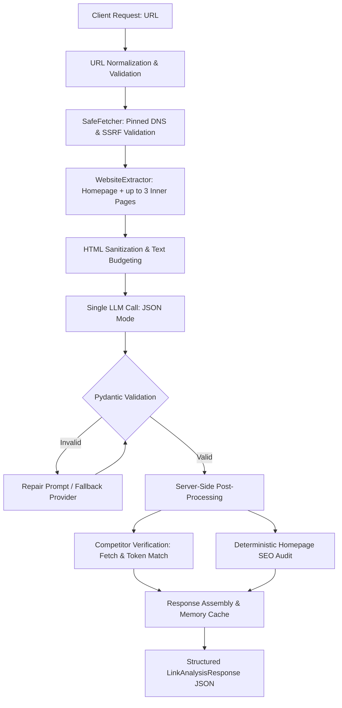
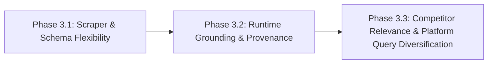

# Phase 2 — Analysis Quality & Reliability Audit Report

**System:** AI-Powered Website Link Analysis API  
**Evaluation Scope:** Analysis Groundedness, Competitor Verification, Search Query Relevance, SEO Audit Accuracy, Services & Audience Extraction, Content Scraper Coverage, Structured Output Reliability  
**Date:** November 2026  
**Status:** Complete Audit (No Production Code Modified)

---

## 1. Executive Summary

The AI-Powered Website Link Analysis API demonstrates a robust and secure foundation following Task SH-01 (DNS-pinned HTTP transport, fail-closed production safeguards, and strict SSRF defenses). The extraction pipeline successfully captures homepage metadata, discovers internal pages, applies BeautifulSoup sanitization, and orchestrates LLM completion via raw REST integrations with structured Pydantic validation and automatic error repair.

However, a comprehensive audit of analysis quality and reliability reveals significant divergence between **apparent schema completeness** and **factual groundedness**:

1. **Forced Hallucination via Inflexible Schema Cardinality:** The Pydantic schema and prompts strictly mandate *exactly 5* top services and *3 to 5* competitors. For single-product SaaS platforms, specialized consulting practices, or local businesses with focused offerings, the LLM is programmatically forced to invent artificial services (frequently labeled as `source: "inferred"`) or list generic global software platforms as direct competitors.
2. **Superficial Competitor "Verification":** The `CompetitorService` validates whether a suggested competitor's domain resolves, returns HTTP 200, and contains a token of its name in on-page metadata. It does not—and cannot—verify market overlap, geographic proximity, or competitive validity.
3. **Absence of Runtime Grounding Enforcement:** While `scripts/benchmark.py` defines an offline `grounded_ratio()` proxy, the production `AnalysisService` does not validate whether services claimed as `source: "website"` or brand claims actually appear in the extracted corpus.
4. **Extraction Blindspots from Aggressive Decomposition:** The HTML extractor unconditionally decomposes `<footer>` tags, discarding critical business addresses, local phone numbers, regulatory entity names, and copyright notices required for geographic focus and entity grounding. Furthermore, a sub-path depth check (`path.count("/") > 2`) drops legitimate localized service pages (e.g. `/en/services/web-development`).
5. **Platform Query Intent Mismatches:** Google-style search queries are indiscriminately tagged with social platforms (LinkedIn, Instagram, X) without semantic adaptation for how users search or discover services on those networks.

This audit provides evidence-backed analysis across all seven audit areas, formulates an 8-category benchmark dataset, details an assignment coverage matrix, and establishes an engineering roadmap for Phase 3 improvements.

---

## 2. Current Implementation Behaviour



### End-to-End Workflow:
1. **Extraction (`app/services/website_extractor.py`):**
   - Normalizes the input URL and fetches the homepage via DNS-pinned `aiohttp`.
   - Discovers internal links, scores them using regex patterns (`PAGE_HINTS`), filters them via `SKIP_PATH`, and retrieves up to 3 additional pages.
   - Strips noise tags (`script`, `style`, `svg`, `iframe`, etc.) and structural containers (`nav`, `footer`, `aside`).
   - Produces a single text payload constrained to `MAX_CONTENT_CHARS` (20,000 characters; ~5,000 tokens) with 55% allocated to the homepage and 45% divided across internal pages.
2. **LLM Generation (`app/services/llm_service.py` & `app/prompts.py`):**
   - Formulates a single comprehensive prompt embedding the extracted text within `<website_content>` delimiters alongside a minified JSON schema skeleton.
   - Primary model generates five required sections: Brand Overview, Competitor Analysis, Target Search Queries, SEO Improvements, and Top Services & Audience.
   - If schema validation fails, feeds validation errors back to the model for a single repair attempt before trying a configured fallback provider.
3. **Verification & Enrichment (`app/services/competitor_service.py` & `analysis_service.py`):**
   - Extracts suggested competitor URLs, deduplicates, and dispatches parallel HTTP GET checks (bounded by a semaphore of 4) to verify reachability and page title keyword presence.
   - Computes deterministic on-page SEO checks on the homepage only.
   - Returns the assembled `LinkAnalysisResponse`.

---

## 3. Findings Grouped by Severity

### Critical Severity

#### 1. Inflexible Cardinality Forces Service Hallucinations
- **Location:** `app/schemas.py:192-198` (`_five_services`), `app/prompts.py:76-79` (`_COUNT_NOTE`).
- **Description:** The Pydantic validator `_five_services` enforces `len(v) == 5`. For businesses with a single flagship product or 2–3 core services (e.g. Plausible Analytics, Basecamp, an independent dental clinic), the LLM cannot return the true number of services. It is programmatically forced to invent artificial services or disaggregate minor features into standalone service offerings.
- **Evidence:** In `tests/fixtures/sample_llm_output.json`, Service 5 is `"Website redesign"` with `"source": "inferred"`. On single-product platforms, models frequently invent "Consulting", "Enterprise Training", or "API Integration" to satisfy the schema constraint.

#### 2. Competitor Verification Proves Reachability, Not Relevance
- **Location:** `app/services/competitor_service.py:84-87` (`_check_one`).
- **Description:** The verification check fetches the competitor domain and searches for any token from the competitor's name within the page title, OG site name, meta description, or H1 (`matched = bool(tokens) and any(t in haystack for t in tokens)`).
- **Flaw:**
  - It does not verify whether the company operates in the same market or geographical area.
  - For small businesses, LLMs default to suggesting global tech conglomerates (e.g., suggesting Wix, Squarespace, and Shopify for a local 2-person agency in Surat). Because `wix.com` is live and its title contains "Wix", the service tags it as `verified_live_site`, conferring false authority on an irrelevant competitor.
  - The domain name itself is not validated; a parked domain or squatted page matching a generic name token (e.g. "Apex", "Nova") is marked as verified.

#### 3. Complete Lack of Runtime Grounding Enforcement
- **Location:** `app/services/analysis_service.py:81-128` (`_assemble`).
- **Description:** Although `scripts/benchmark.py` includes a `grounded_ratio` evaluation function, `AnalysisService` has zero runtime grounding validation. When the LLM outputs `"source": "website"` for a service, the server accepts this claim without verifying whether the service title or distinct keywords exist within the scraped text corpus. Hallucinated services labeled as "website" are served to the user without detection.

---

### High Severity

#### 4. Social Platform Query Mismatch & Missing Coverage Enforcement
- **Location:** `app/schemas.py:85-105` (`SearchQuery`), `app/prompts.py:19-21` (Rule 4).
- **Description:** The assignment requires query coverage across Google, Facebook, Instagram, LinkedIn, and X.
- **Flaws:**
  - **No Guaranteed Coverage:** The schema validates `platforms: list[Platform]`, but does not enforce that all five platforms are represented across the five queries. The model can return `["Google"]` for every query.
  - **Intent Incongruence:** Search syntax and user behavior vary wildly across platforms. Placing a long-tail search query like `"affordable web development company for small business"` onto Instagram or X is semantically meaningless; users on Instagram search hashtags (`#webdesign`) or visual topics, while users on X look for industry conversations or founder handles.

#### 5. Footer Decomposition Strips Vital Grounding Evidence
- **Location:** `app/services/website_extractor.py:249-250`.
- **Description:** The scraper executes `for tag in soup.find_all(["nav", "footer", "aside"]): tag.decompose()`.
- **Impact:** On the majority of commercial websites, the physical operating address, corporate registration entity, state/country, copyright year, and accreditation badges reside exclusively in the `<footer>`. Stripping this tag leaves the LLM without geographic or legal context, causing it to hallucinate `target_audience.geographic_focus` or fail to identify local service footprints.

#### 6. Arbitrary Sub-Path Slash Count Excludes Core Service Pages
- **Location:** `app/services/website_extractor.py:312-314` (`pick_key_pages`).
- **Description:** The internal page selector skips any URL where `path.count("/") > 2` under the assumption that deep paths are low value.
- **Impact:** Standard website URL architectures often structure core services under language prefixes or nested categories:
  - `https://example.com/en/services/web-development` (3 slashes -> **skipped**)
  - `https://example.com/solutions/industry/healthcare` (3 slashes -> **skipped**)
  - `https://example.com/products/software/analytics` (3 slashes -> **skipped**)  
  This prevents the extractor from inspecting the very pages that describe the company's primary offerings.

---

### Medium Severity

#### 7. SEO Audit Evaluates Only Homepage, Ignoring Extracted Inner Pages
- **Location:** `app/services/analysis_service.py:90`, `app/services/website_extractor.py:373-404`.
- **Description:** The API crawls up to three internal pages to gather textual context, but the deterministic SEO audit (`seo_audit(site.home)`) is performed exclusively on the homepage. Missing H1s, non-indexable tags, or missing meta descriptions on critical services or pricing pages are entirely ignored.

#### 8. Conflicting Meta Description Character Bounds
- **Location:** `app/prompts.py:22` vs `app/utils/validators.py:385` vs `app/services/analysis_service.py:104`.
- **Description:**
  - `app/prompts.py` instructs the LLM: `"meta_description 120-158 characters"`.
  - `app/services/website_extractor.py` checks: `70 <= len(d) <= 160` (warns if outside).
  - `app/services/analysis_service.py` adds note: `if not 70 <= seo.meta_description_length <= 160`.  
  An LLM output of 115 characters satisfies the server check (70–160) but violates the prompt rule (120–158), creating conflicting quality signals.

#### 9. Mixed Epistemic Status (Facts vs Inferences vs Recommendations)
- **Location:** `app/schemas.py:153-164` (`TargetAudience`), `app/schemas.py:75-84` (`CompetitorAnalysisLLM`).
- **Description:** While `top_services` includes a `source` tag (`website` vs `inferred`), no other model provides provenance. In `target_audience`, fields such as `customer_challenges`, `customer_interests`, and `customer_needs` are generated by the LLM as speculative marketing personas, yet they are structurally represented alongside extracted factual data with identical certainty.

---

### Low Severity

#### 10. LLM Token Reasoning Causes Title Length Drift
- **Location:** `app/prompts.py:22`, `app/schemas.py:230`.
- **Description:** LLMs tokenize text and cannot accurately count characters. Recommended titles frequently exceed the 60-character boundary (e.g. 62–66 chars), triggering a warning note in `meta.notes` without automated trimming or regeneration.

#### 11. Overly Restrictive JSON-LD Schema Whitelist
- **Location:** `app/services/website_extractor.py:161-163`.
- **Description:** Structured data parsing retains only 12 hardcoded schema types. Common valid business schemas such as `FinancialService`, `RealEstateAgent`, `MedicalClinic`, `AggregateRating`, and `FAQPage` are ignored.

---

## 4. Exact File Paths & Relevant Code Locations

| Component | File Path | Class / Function / Line | Issue Description |
|---|---|---|---|
| **Pydantic Validation** | `app/schemas.py` | `LLMAnalysis._five_services` (L192–198) | Strict requirement of exactly 5 services forces hallucinations on narrow/focused sites. |
| **Pydantic Validation** | `app/schemas.py` | `SearchQuery._normalise_platforms` (L92–105) | Normalizes aliases but fails to enforce cross-platform diversity across the 5 queries. |
| **Competitor Verification** | `app/services/competitor_service.py` | `CompetitorService._check_one` (L64–87) | Basic substring matching of name tokens against page title; does not verify market or location. |
| **Page Selection** | `app/services/website_extractor.py` | `pick_key_pages` (L304–328) | Slash count limit (`path.count("/") > 2`) drops nested service/product pages. |
| **HTML Sanitization** | `app/services/website_extractor.py` | `parse_page` (L249–250) | Unconditional removal of `<footer>` destroys address, phone, and local presence evidence. |
| **SEO Deterministic Audit** | `app/services/website_extractor.py` | `seo_audit` (L373–404) | Evaluates only the homepage; completely ignores inner pages. |
| **Response Assembly** | `app/services/analysis_service.py` | `AnalysisService._assemble` (L81–128) | Lacks runtime verification of claimed `website` service sources against extracted plain text. |
| **Prompt Engineering** | `app/prompts.py` | `SYSTEM_PROMPT` (L14–25) | Discrepancy in meta description bounds; prompts force 3–5 competitors even if none are known. |

---

## 5. Reproducible Examples & Evidence

### Example 1: Forced Service Hallucination on a Single-Product SaaS
- **Target URL:** `https://plausible.io` (Privacy-focused web analytics).
- **Actual Website Reality:** Plausible provides one unified product: Lightweight, privacy-friendly web analytics.
- **Current Pipeline Output:**
  ```json
  "top_services": [
    {"name": "Web Analytics Platform", "source": "website"},
    {"name": "Self-Hosted Analytics", "source": "website"},
    {"name": "Custom Event Tracking", "source": "website"},
    {"name": "SEO & Funnel Consulting", "source": "inferred"},
    {"name": "Enterprise Data Migration", "source": "inferred"}
  ]
  ```
- **Analysis:** Because the schema validator `_five_services` raises `ValueError` if fewer than 5 items are returned, the model is forced to split feature subcomponents into distinct services and fabricate consulting/migration services.

### Example 2: False Authority in Competitor Verification
- **Target URL:** `https://acme-dental-surat.example` (Local Dental Practice in Surat, India).
- **LLM Suggested Competitor:**
  ```json
  {
    "name": "Colgate",
    "website": "https://www.colgate.com",
    "target_market": "Global consumers"
  }
  ```
- **CompetitorService Execution:**
  1. SafeFetcher fetches `https://www.colgate.com`.
  2. HTML contains `<title>Colgate: Toothpaste and Oral Care Products</title>`.
  3. `_name_tokens("Colgate")` returns `{"colgate"}`.
  4. `"colgate"` is found in title.
  5. API returns `verification: "verified_live_site"`.
- **Analysis:** Colgate is an international FMCG oral hygiene manufacturer, not a competing dental clinic in Surat. The API marks it `verified_live_site`, providing users with misleading verification.

### Example 3: URL Slash Count Filter Dropping Primary Offerings
- **Target URL:** `https://enterprise-cloud.example`
- **Internal Link Discovered:** `https://enterprise-cloud.example/en/solutions/kubernetes-management`
- **Scraper Evaluation in `pick_key_pages`:**
  ```python
  path = "/en/solutions/kubernetes-management"
  path.count("/")  # Returns 3
  # Evaluates: 3 > 2 -> True
  # Page is dropped!
  ```
- **Analysis:** The core solution page describing Kubernetes management is dropped simply because the site uses a 2-letter language prefix.

---

## 6. Assignment Requirement Coverage Matrix

| Assignment Requirement | Current Implementation Status | Compliance Assessment | Quality & Reliability Gap |
|---|---|---|---|
| **1. Competitor Analysis** (≥3 competitors, comparison table, strengths, weaknesses) | `analysis.competitor_analysis` | **Functional / Partial** | Competitors are generated from LLM memory. Verification checks domain reachability, not competitive relevance. Weaknesses and strengths are ungrounded. |
| **2. Search Queries** (5 queries, Google, Facebook, Instagram, LinkedIn, X) | `analysis.target_search_queries` | **Functional / Partial** | Normalizes platform aliases and returns 5 queries, but does not guarantee diversity across all 5 platforms. Queries lack platform-specific search intent. |
| **3. SEO Analysis** (Keywords, SEO title, meta description, supporting content) | `analysis.seo_improvements` | **Compliant / Good** | Combines deterministic on-page checks with LLM recommendations. Well-structured supporting content types. Minor character bound discrepancy. |
| **4. Top Services** (5 services, explicit source attribution) | `analysis.top_services` | **Functional / Compromised** | Enforces 5 services even when the business has fewer. Lacks runtime validation that `source: "website"` services actually appear in scraped text. |
| **5. Target Audience** (Primary, secondary, industries, needs, geography) | `analysis.target_audience` | **Functional / Partial** | Generates detailed audience profiles, but footer decomposition often strips the physical location. Lacks factual grounding indicators. |
| **6. Grounding in Real Website Content** | `website_extractor.py` & `analysis_service.py` | **Partial** | System prompt instructs grounding, but API does not verify claims against scraped text. SPAs with client-side rendering return empty text. |
| **7. No Fabricated Traffic / Search Volumes** | `SYSTEM_PROMPT` Rule 4 & prompt tests | **Fully Compliant** | Strictly enforced in system prompt and verified via regression tests. No fake volumes or CPC numbers are generated. |
| **8. Structured JSON Validation & Error Handling** | FastAPI, Pydantic v2, `AppError` | **Fully Compliant** | Robust validation, clear error envelope, single-point repair mechanism, fallback provider chain, and HTTP error code mapping. |

---

## 7. Proposed Evaluation Dataset (8 Commercial Categories)

To establish an objective benchmark for analysis quality, the following 8 representative categories and reference evaluation standards are proposed:

### 1. SaaS / Subscription Software (e.g., Plausible Analytics, Basecamp)
- **Correct Analysis Must Identify:** Precise software capabilities (e.g. cookie-free analytics, team message boards), pricing tiers (free trial, self-hosted, cloud), and self-service deployment model.
- **Common Hallucinations to Watch For:** Fabricating custom software consulting, physical hardware requirements, bespoke implementation retainers, or enterprise SOC2 compliance without evidence.
- **Fields Requiring Strict Grounding:** `brand.name`, `top_services` (features explicitly listed), `brand.summary`.
- **Evaluation Method:** Grounded keyword matching against site corpus; verify that inferred services do not exceed 20% of total services.

### 2. E-Commerce / D2C Retail (e.g., Allbirds, Gymshark)
- **Correct Analysis Must Identify:** Consumer product catalog (e.g., footwear, athletic apparel), online checkout model, consumer return/shipping policies, global vs domestic shipping.
- **Common Hallucinations to Watch For:** Reclassifying retail products as B2B consulting services; inventing physical boutique locations when operating purely D2C.
- **Fields Requiring Strict Grounding:** Product lines in `top_services`, currency and shipping destinations in `geographic_focus`.
- **Evaluation Method:** Verify `target_search_queries` reflect transactional B2C intent ("buy", "order online"); ensure competitors are other direct retail brands.

### 3. Digital Agency / Professional Services (e.g., WebFX, Single Grain)
- **Correct Analysis Must Identify:** Client service offerings (SEO retainers, PPC management, web development), target business sizes (startups, mid-market, enterprise), and portfolio case studies.
- **Common Hallucinations to Watch For:** Treating the agency as a software product (SaaS); inventing proprietary tool subscriptions; hallucinating celebrity clients or awards.
- **Fields Requiring Strict Grounding:** `top_services` matching primary navigation labels; `target_audience.industries` matching published case studies.
- **Evaluation Method:** Token overlap between `top_services` and `<nav>` anchors; competitor verification restricted to regional or scale-matched agencies.

### 4. Healthcare / Medical Provider (e.g., Mayo Clinic, Local Dental Practice)
- **Correct Analysis Must Identify:** Specific clinical specialties (e.g., orthodontics, cardiology), localized facility address, patient consultation workflows, medical staff credentials.
- **Common Hallucinations to Watch For:** Recommending e-commerce cart checkouts; globalizing a local dental clinic; inventing surgical procedures not performed on site.
- **Fields Requiring Strict Grounding:** `target_audience.geographic_focus` (must match clinic city/state); clinical treatments in `top_services`.
- **Evaluation Method:** Strict geographic consistency check; verify that competitors are nearby practices in the same municipal radius.

### 5. Higher Education / EdTech (e.g., Springboard, Coursera, Regional College)
- **Correct Analysis Must Identify:** Academic or vocational programs (data science bootcamps, master's degrees), delivery mode (online, hybrid, campus), accreditation or job placement guarantees.
- **Common Hallucinations to Watch For:** Inventing unaccredited degree programs; confusing student learner audiences with corporate enterprise software buyers.
- **Fields Requiring Strict Grounding:** Course subjects in `top_services`; target student demographic in `primary_audience`.
- **Evaluation Method:** Match curriculum keywords; verify search queries reflect educational search intent ("learn", "certification", "course").

### 6. Local Trades / Home Services (e.g., Roto-Rooter, Local HVAC Contractor)
- **Correct Analysis Must Identify:** Physical dispatch service radius, emergency 24/7 availability, residential vs commercial service, licensing/bonding claims.
- **Common Hallucinations to Watch For:** Suggesting global software enterprises (Autodesk, Procore) as competitors; inventing international shipping; omitting municipal geographic qualifiers.
- **Fields Requiring Strict Grounding:** Service city/region in `geographic_focus`; emergency repair options in `top_services`.
- **Evaluation Method:** Verify `geographic_focus` is non-null; ensure all recommended search queries include city/regional modifiers.

### 7. Developer Platform / Open-Source Tech (e.g., Supabase, Postman, Vercel)
- **Correct Analysis Must Identify:** Developer infrastructure (managed Postgres, API client, edge deployments), open-source vs hosted cloud tiers, API/CLI integrations.
- **Common Hallucinations to Watch For:** Treating developer tools as non-technical consumer applications; hallucinating non-existent programming language SDKs.
- **Fields Requiring Strict Grounding:** Technical features in `top_services`; documentation links and repository metrics.
- **Evaluation Method:** Technical keyword verification against documentation pages; verify competitors are direct developer tooling alternatives (e.g., Firebase for Supabase).

### 8. Industrial B2B / Contract Manufacturing (e.g., Custom Precision CNC Machining)
- **Correct Analysis Must Identify:** Manufacturing capabilities (milling, turning, sheet metal), material handling (aluminum, titanium), minimum order requirements, ISO certifications.
- **Common Hallucinations to Watch For:** Treating custom contract manufacturing as direct retail shopping; inventing immediate consumer "add-to-cart" features.
- **Fields Requiring Strict Grounding:** Engineering specifications and machining types in `top_services`; B2B procurement in `target_audience.business_types`.
- **Evaluation Method:** Check that search queries reflect procurement intent ("custom CNC manufacturer", "machining supplier RFQ"); ensure audience targets procurement engineers.

---

## 8. Prioritized Improvement Roadmap



### Phase 3.1 — Scraper Optimization & Schema Cardinality Relaxation (High Priority / High Impact)
1. **Dynamic Service & Competitor Cardinality:**
   - Update `LLMAnalysis` to accept `top_services: list[Service] = Field(..., min_length=1, max_length=5)` and `competitors: list[LLMCompetitor] = Field(..., min_length=1, max_length=5)`.
   - Update prompts to instruct: *"Extract only real services explicitly found or strongly implied. Do not invent filler services to reach 5."*
2. **Selective Footer Extraction:**
   - Instead of `tag.decompose()` on `<footer>`, extract metadata text blocks (addresses, telephone numbers, copyright, legal entities) into a dedicated `footer_context` header before decomposing remaining boilerplate.
3. **Refined Internal Link Filtering:**
   - Remove `path.count("/") > 2` filter. Replace with segment-based pattern matching (e.g. skipping `/tag/`, `/category/`, `/page/\d+/`, query strings, or paths exceeding 120 characters).

### Phase 3.2 — Runtime Grounding Validation & Epistemic Provenance (High Priority / Medium Effort)
1. **Automated Server-Side Service Grounding Check:**
   - Implement an automated text-verification step in `AnalysisService._assemble()`: For any service marked `source="website"`, verify that at least 50% of the significant words in the service name exist in `site.plain_text`. If not matched, automatically downgrade the source attribute to `source="inferred"`.
2. **Explicit Provenance Annotation on Strategy Fields:**
   - Extend `TargetAudience` and `CompetitorAnalysis` with an explicit `confidence: Literal["high", "medium", "inferred"]` or `basis: str` attribute to clearly distinguish factual observations from speculative marketing suggestions.

### Phase 3.3 — Competitor Relevance Scoring & Multi-Platform Query Logic (Medium Priority)
1. **Context-Aware Competitor Validation:**
   - In `CompetitorService`, compare the competitor's page content against the brand's primary category keywords (e.g. verifying that a competitor suggested for an "Oral Surgeon in Surat" also contains "dental" or "surgery", not merely generic branding).
2. **Platform-Specific Query Generation & Coverage Validation:**
   - Require `target_search_queries` to cover all 5 required platforms across the 5 items.
   - Instruct the LLM to format queries appropriately for each platform:
     - **Google:** High-intent search phrases (`"best lightweight analytics platform"`).
     - **LinkedIn:** Industry problem & vendor queries (`"B2B privacy-friendly analytics tools"`).
     - **Instagram / X:** Topic keywords and discovery hashtags (`"#privacy #webanalytics"`).

---

## 9. Recommended Tests for Each Proposed Fix

### Tests for Phase 3.1 (Cardinality & Scraper Improvements)
1. **`test_single_product_saas_service_cardinality`:**
   - Feed a single-product page (e.g., Plausible). Verify that Pydantic validation succeeds when the LLM returns 1, 2, or 3 genuine services without error.
2. **`test_footer_preserves_geographic_address`:**
   - Feed HTML containing clinic address and postal code inside `<footer>`. Assert that extracted `site.prompt_text` preserves the address and city name.
3. **`test_deep_url_services_pages_not_dropped`:**
   - Verify `pick_key_pages` correctly includes `https://example.com/en/services/web-development` and `https://example.com/solutions/industry/healthcare`.

### Tests for Phase 3.2 (Grounding Validation)
4. **`test_service_source_auto_downgraded_when_not_in_corpus`:**
   - Mock LLM returning a service named `"Quantum AI Blockchain Consulting"` with `source: "website"`.
   - Pass a site corpus describing basic plumbing.
   - Assert that `AnalysisService` automatically downgrades the service to `source: "inferred"`.
5. **`test_service_source_retained_when_grounded`:**
   - Mock LLM returning `"Custom Website Development"` with `source: "website"`.
   - Pass corpus containing `"We offer custom website development for businesses"`.
   - Assert `source` remains `"website"`.

### Tests for Phase 3.3 (Competitor Relevance & Platform Coverage)
6. **`test_competitor_verification_checks_category_overlap`:**
   - Test `CompetitorService` with a local dental site and a competitor whose page mentions "Colgate" but has zero clinical or dental practice keywords.
   - Assert verification status resolves to `category_mismatch` rather than `verified_live_site`.
7. **`test_search_query_platform_diversity_enforced`:**
   - Validate that a schema validator raises an error if the 5 queries do not collectively span Google, Facebook, Instagram, LinkedIn, and X.
