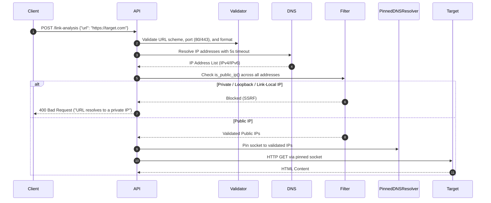

# Security, Reliability & Production Deployment Audit

This document details the security safeguards, failure recovery mechanisms, and production deployment configuration for the **AI Website Link Analysis API**.

---

## 1. Security & Production Configuration Review

### Environment Variables & Secrets Protection
- **No Hardcoded Secrets:** All provider API keys (`OPENAI_API_KEY`, `ANTHROPIC_API_KEY`, `GEMINI_API_KEY`, `GROQ_API_KEY`) are managed strictly through environment variables loaded via Pydantic `BaseSettings`.
- **Pydantic `SecretStr` Obfuscation:** Secret keys are stored as `SecretStr`, preventing inadvertent string formatting, logging, or exception dumps from printing raw credentials.
- **`.gitignore` Enforcement:** The `.gitignore` file strictly blocks `.env`, local virtual environments (`.venv/`), logs, and test artifacts from being committed.
- **Fail-Closed Production Safety:**
  ```python
  @model_validator(mode="after")
  def _validate_environment_and_security(self) -> Settings:
      if self.environment == "production" and self.allow_private_urls:
          raise ValueError(
              "Unsafe configuration: ALLOW_PRIVATE_URLS cannot be enabled in production environment. "
              "The application has failed closed to prevent SSRF vulnerabilities."
          )
      return self
  ```
  If an operator mistakenly sets `ALLOW_PRIVATE_URLS=true` while `ENVIRONMENT=production`, the application crashes immediately at startup, preventing accidental SSRF bypass in production.

---

## 2. SSRF & DNS-Pinned Transport Hardening (SH-01)

The system prevents Server-Side Request Forgery (SSRF) and DNS rebinding attacks using a custom DNS-pinned asynchronous HTTP transport (`PinnedDNSResolver` + `SafeFetcher`):



### Key Transport Guarantees
1. **DNS Rebinding Immunity:** DNS resolution occurs once; the socket connection is pinned directly to the validated IP addresses, eliminating time-of-check-to-time-of-use (TOCTOU) DNS rebinding vulnerabilities.
2. **Private Address Filtering:** Disallows all IPv4 and IPv6 loopback (`127.0.0.0/8`, `::1`), private networks (`10.0.0.0/8`, `172.16.0.0/12`, `192.168.0.0/16`), link-local metadata addresses (`169.254.169.254`), and documentation/broadcast blocks.
3. **Strict Port Restrictions:** Only standard HTTP (`80`) and HTTPS (`443`) ports are allowed. Non-standard ports (e.g. `22`, `8080`, `6379`, `27017`) are immediately rejected with `400 Bad Request`.
4. **Bounded Fetching:** Enforces a 2MB maximum byte limit and streaming abort to protect against zip-bombs or endless stream payloads.
5. **Safe Redirect Tracking:** Redirects are manually inspected step-by-step; cross-scheme or private target redirects are blocked before any socket is opened.

---

## 3. Reliability & Failure Handling

### Error Handling Matrix

| Scenario / Trigger | HTTP Code | Error Code | Client Response Message | Internal Handling |
|---|---|---|---|---|
| **Invalid URL Syntax / Missing Scheme** | `422` | `invalid_request` | `Request body must be JSON like {"url": "https://example.com"}.` | Pydantic validation error |
| **Private IP / SSRF Attempt** | `400` | `ssrf_blocked` | `Target URL resolves to a prohibited internal or private IP address.` | Blocked prior to HTTP request |
| **Non-Standard Port (`:8080`)** | `400` | `port_not_allowed` | `Only ports 80 and 443 are supported.` | URL validator reject |
| **DNS Resolution Failure (NXDOMAIN)** | `422` | `dns_resolution_failed` | `Could not resolve hostname.` | Caught by DNS resolver |
| **Target Website Timeout** | `504` | `fetch_timeout` | `The target website did not respond in time.` | 12s timeout enforcement |
| **Target Returns Non-HTML (e.g. PDF)** | `415` | `not_html` | `The target URL did not return HTML content.` | Content-Type header check |
| **Target 403 Forbidden / 429 Rate Limit** | `422` | `site_inaccessible` | `Target website denied access or rate-limited the request.` | Status code handling |
| **LLM Provider Rate Limited (429)** | `503` | `llm_rate_limited` | `The LLM provider is rate limiting requests. Please retry shortly.` | Exponential retry -> AppError |
| **Malformed LLM Output** | `502` | `llm_invalid_response` | `The LLM returned unparseable content.` | JSON repair -> fallback -> AppError |
| **Unhandled Exception** | `500` | `internal_error` | `Unexpected server error.` | Generic error returned; traceback logged |

### Zero Information Leakage
- Unhandled 500 exceptions return a sanitized message (`"Unexpected server error."`).
- No internal stack traces, system paths, or credential variables are ever returned in JSON error payloads.

---

## 4. Production Deployment & Readiness

### Container Configuration (`Dockerfile`)
- **Base Image:** `python:3.12-slim` for minimal vulnerability surface area.
- **Non-Root Execution:** Dedicated non-privileged user `appuser` executes the container process.
- **Dynamic Port Binding:** Supports `$PORT` injection for cloud container platforms (Render, Railway, Fly.io, Cloud Run) with a fallback to `4000`.

### Health & Liveness Check (`/health`)
- Returns JSON with service status, active provider, model name, and configuration state:
  ```json
  {
    "status": "ok",
    "provider": "groq",
    "model": "openai/gpt-oss-120b",
    "llm_configured": true
  }
  ```

### Render Blueprint (`render.yaml`)
- Ready for one-click deployment to Render Web Services.
- Configured with automatic health checking at `/health` and proxy header trust for accurate IP-based rate limiting.
